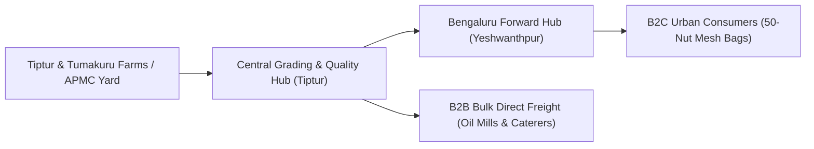

# Tiptur Direct: Agricultural E-Commerce Platform

> **Farm-Direct Coconuts & GI Copra from Karnataka's Premier Agricultural Corridor**  
> Serving Bengaluru Urban Households (B2C) & South Indian Industrial Buyers (B2B).

---

## 🌴 Architectural Overview

Tiptur Direct operates a **Hybrid Hub Model** anchoring physical quality inspection and standardized grading at the farm-gate / APMC mandi in **Tiptur, Tumakuru District**, fulfilling:
1. **Retail Consumers (B2C)**: 50-nut breathable HDPE mesh bags delivered to Bengaluru urban households within 24–48 hours via hyperlocal/courier 3PLs.
2. **Wholesale & Bulk Buyers (B2B)**: 500 to 20,000+ nut truckloads/tempo lots supplied directly to cold-pressed oil expellers, darshini restaurant chains, caterers, and supermarkets with guaranteed 48-hour price locks, 100% digital weighbridge slips, and full GST ITC compliance.



---

## 🚀 Technology Stack

* **Frontend**: Next.js 15 (App Router), React 19, TypeScript, Tailwind CSS v4, Lucide Icons.
* **Backend**: Next.js Server Actions & API Route Handlers.
* **Database**: PostgreSQL 16 (with connection pooling via `pg`).
* **Payment Architecture**: Dual-rail support for simulated Razorpay/Cashfree (UPI intent, Cards, NetBanking, COD).
* **Testing**: Automated Business Rule & QA Test Suite (`tsx src/tests/run-tests.ts`).

---

## 🛠️ Getting Started & Setup

### 1. Environment Configuration
Create `.env.local` in the project root:

```bash
DATABASE_URL="postgresql://apple@localhost:5432/tiptur_direct"
NEXT_PUBLIC_APP_NAME="Tiptur Direct"
NEXT_PUBLIC_APP_TAGLINE="Farm-Gate Coconuts & GI-Certified Copra from Karnataka"
NEXT_PUBLIC_FREE_DELIVERY_THRESHOLD="1500"
NEXT_PUBLIC_WHATSAPP_SUPPORT="+919876543210"
RAZORPAY_KEY_ID="rzp_test_tiptur_demo"
```

### 2. Database Migration & Seeding
Ensure PostgreSQL is running, then run:

```bash
# Initialize schema tables and seed certified products, inventory batches, and regional pin codes:
npm run db:seed
```

### 3. Running Automated QA Tests
Execute the unit and business logic test suite:

```bash
npm test
```

### 4. Running the Development Server
```bash
npm run dev
# Open http://localhost:3000 in your browser
```

### 5. Production Build
```bash
npm run build
npm start
```

---

## 📋 Core API Endpoints

| Method | Endpoint | Description |
| :--- | :--- | :--- |
| `GET` | `/api/products` | Retrieve active products with live available inventory counts. |
| `GET` | `/api/pincode/check?pincode=560001` | Validate postal pin code delivery eligibility and hub lead times. |
| `POST` | `/api/orders` | Place B2C retail order with atomic stock reservation and free shipping rules. |
| `GET` | `/api/orders?phone=9845012345` | Query recent customer orders by phone or order number. |
| `POST` | `/api/rfq` | Submit B2B wholesale Request for Quotation with dynamic freight estimator. |
| `GET` | `/api/rfq` | Retrieve submitted wholesale RFQs for commercial desk review. |
| `PATCH` | `/api/admin/rfqs` | Update wholesale quotes (adjust proposed price, freight, issue quote, mark accepted). |
| `PATCH` | `/api/admin/orders` | Execute strict order status state transitions (`paid` $\to$ `allocated` $\to$ `packed` $\to$ `dispatched` $\to$ `delivered`). |
| `GET` | `/api/admin/inventory` | List all harvest inventory batches with origin mandi and spoilage stats. |
| `POST` | `/api/admin/inventory` | Log new harvest intake batch or record damaged/shrinkage write-off. |
| `GET` | `/api/admin/metrics` | Calculate real-time P&L analytics, sales, AOV, pipeline value, and spoilage rate. |

---

## 📑 Operations Portal

Navigate to `/admin` to access the commercial desk:
* **Wholesale RFQs Tab**: Manage wholesale quote pipeline and WhatsApp buyer linkages.
* **Retail Orders Tab**: Manage pick-and-pack workflow and 3PL dispatch tracking.
* **Inventory Batches Tab**: Log incoming truckloads from Tiptur APMC and record sorting inspection write-offs.
* **Commercial P&L Tab**: View live contribution margin (CM1) economics for retail mesh bags and bulk metric ton consignments.
